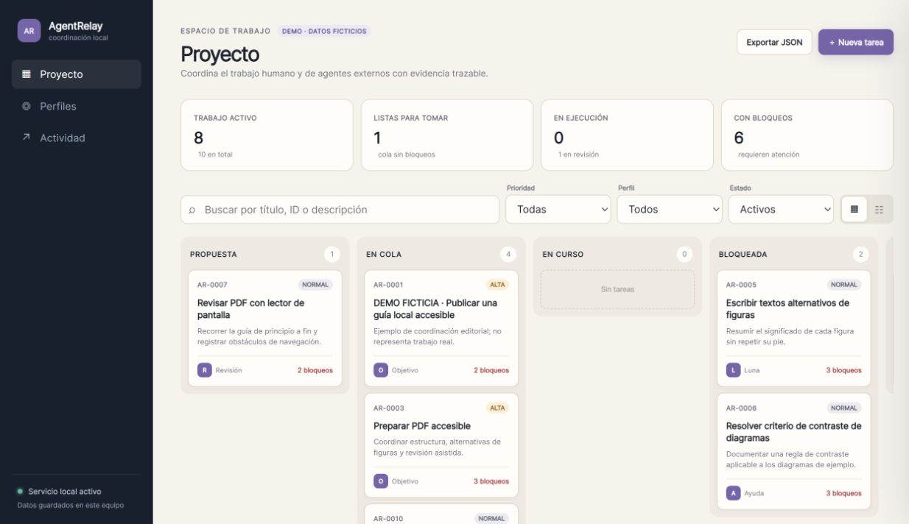

# AgentRelay

**A local project board that agents can actually work with.**

Turn goals into prioritized tickets, share durable context between agents, and keep delivery separate from acceptance. Humans use the web board; agents use the MCP server. Both operate on the same SQLite database.

AgentRelay 0.1 is a working local coordination application, not an autonomous agent launcher. It makes no inference calls. Model profiles are recommendations; actual settings are separately declared by the connected worker.



## Try it

Requires Python 3.11+. The web app and domain service use only the standard library. No frontend build, CDN, cloud account or API key is needed.

```sh
python -m agentrelay serve --demo
```

Open **http://127.0.0.1:8787**. The demo is explicitly fictional and lives in `.agentrelay/demo.sqlite`. To use an empty real workspace instead:

```sh
python -m agentrelay serve
```

That uses `.agentrelay/workspace.sqlite`. Stop the first server or use another `--port`. Each database represents one project. Always pass an **absolute `--db` path** when connecting agents to an existing workspace; relative paths depend on the process's working directory.

Windows quick launch: `powershell -File .\Start-AgentRelay.ps1 -Demo`. It prefers `.runtime` (the development environment) or `.venv`, and runs the local web service hidden with logs under `.agentrelay`. It never installs packages or configures clients automatically.

## What works

- Searchable Kanban and list views, urgency and priority, proposed/queued/running/blocked/review/done/cancelled states.
- Task descriptions, acceptance criteria, nested subtasks and explicit dependencies.
- Agent profiles with role, provider, model, recommended effort, capabilities and quality/speed preference.
- Atomic claiming and optimistic revisions: two writers cannot silently overwrite the same ticket.
- Checkpoints, comments, help requests and task splitting with preserved history.
- Independent review with evidence references and explicit acceptance; cyclic dependency/hierarchy combinations are rejected.
- Persistent audit history, versioned JSON export and isolated demonstration data.
- MCP tools for external agents and a companion [skill](skills/agentrelay-work/SKILL.md).

The initial profiles reflect the local author's workflow: Astra/high coordinates, with Sol, Terra and Luna as specialists. These names do not mean those models are connected or available. Add your own provider/model profiles in **Perfiles**. The Astra coordinator profile is deliberately locked under the current workspace policy.

## Connect an agent via MCP

Install the official MCP SDK in your chosen environment:

```sh
python -m pip install -e ".[mcp]"
```

Configure a stdio MCP entry in a compatible host. Example JSON for hosts using `mcpServers` (replace every absolute path):

```json
{
  "mcpServers": {
    "agentrelay": {
      "command": "/absolute/path/to/venv/bin/agentrelay",
      "args": ["mcp", "--db", "/absolute/path/to/project/.agentrelay/workspace.sqlite", "--actor", "agent:worker-01"]
    }
  }
}
```

On Windows, use the environment's `Scripts/agentrelay.exe`. From an uninstalled checkout, use its Python executable with `-m agentrelay` and set the host's working directory to the repository. [Local configuration example](docs/LOCAL_SETUP.md).

Use a different stable actor name for each worker/reviewer connection. The actor is fixed by the launch command, rather than supplied with each tool call. The MCP layer is for trusted local collaborators; it is not a multi-tenant authentication boundary.

Useful tools: `list_tickets`, `get_ticket_context`, `list_profiles`, `create_ticket`, `update_ticket`, `claim_ticket`, `save_checkpoint`, `request_help`, `split_ticket`, `transition_ticket`, `submit_ticket`, `review_ticket`, `add_comment`. `agentrelay://workflow` exposes the handoff rules as a resource.

## A real workflow

1. Create “Fix PDF pagination”, with concrete acceptance and a target profile.
2. An external worker lists ready work and atomically claims the current revision.
3. It saves findings; if it needs specialist input, it opens a help child with a reproduction. The parent becomes blocked.
4. Another worker delivers the help. After review, the original owner or human explicitly requeues the parent.
5. The worker resumes with the shared context, then submits artifacts for review.
6. A different identity checks every criterion and closes the ticket. Parent goals still need their own integrated review.

Creating a ticket does not start a process. Urgency orders pending work but does not preempt an active agent. Evidence links are recorded references, not automatically verified artifacts.

## Tests and architecture

```sh
python -m unittest discover -s tests -v
```

Install `.[mcp]` to include the real SDK stdio integration test; otherwise it is explicitly skipped. The tests use disposable databases, including a complete help → resume → independent review scenario. No LLM is called.

The project also has browser QA of the human workflow. See [validation](docs/VALIDATION.md), [architecture and boundaries](docs/ARCHITECTURE.md) and [API contract](docs/CONTRACT.md).

The [GitHub Actions template](docs/github-actions-tests.yml) tests Python 3.11/3.12 on Windows and Linux. CI is **not active**: the publishing credential lacks GitHub's `workflow` permission. To enable it with an authorized credential or through the GitHub editor, place the template at `.github/workflows/tests.yml`. Local test results are documented independently of CI.

## Current boundaries

This release coordinates existing agents; it does not launch provider sessions, schedule workers, measure token spend, synchronize GitHub Issues or provide multi-user authentication. Recorded model/effort values are declarations, not provider-attested telemetry. The browser represents one local human identity, so self-authored manual work needs a different reviewer connection.

The service binds only to `127.0.0.1`, checks Host/Origin and rejects cross-origin mutations. Do not expose it through a public proxy. Back up your SQLite database while the server is stopped (or use SQLite's backup API); copying a live WAL database's main file alone is insufficient. JSON export is a portable report; import is not implemented.

MIT licensed. Source stays separate from private project data, environments and logs. No telemetry.
