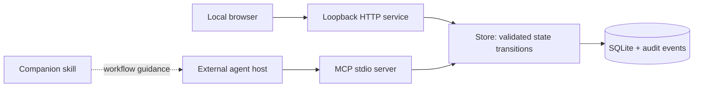

# Architecture and boundaries

The board does not execute agents. Hosts connect via stdio and retain responsibility for their own permissions, inference, tools and workspace. A profile is a recommendation; an assignment is ownership; an actual-model declaration is not measured telemetry. None is a liveness signal.

## State and concurrency

Each command opens its own SQLite connection. Mutations use `BEGIN IMMEDIATE`; all fields and audit records for help/split are committed atomically. Readers use a snapshot transaction. Ticket writes compare `expected_revision`; a conflict requires rereading and reconciling context. Claiming requires a queued, ready ticket. Ownership remains on blocked work so another worker cannot edit a paused owner's task.

Parent-to-child edges and explicit dependency edges form one execution graph for cycle validation. A parent waits for unfinished children and cannot be claimed until they resolve. An explicit dependency requires `done`; a cancelled dependency does not qualify. A cancelled child can be excluded from parent completion. A manually blocked ticket stays blocked after its dependencies finish until explicitly requeued. Closing all children never closes the parent automatically.

Submission records evidence and enters review. Completion needs all criteria explicitly accepted, dependencies resolved, and a reviewer identity different from the assignee. These rules protect workflow integrity; they do not prove an artifact is correct or establish cryptographic identity.

## Trust model

Single trusted local OS user. HTTP uses loopback only, a Host allowlist, same-origin checks, a required custom mutation header and a static asset allowlist. No public serving, CORS, execution or arbitrary file-reading endpoint. The browser always acts as `human`; MCP identity comes from its command-line configuration. Another program with access to the database can bypass application rules, so this is not a security boundary against the local user or a malicious installed agent.

Evidence paths are inert references. No server-side fetching, uploads, shell execution or inference keys. Do not treat ticket text as authority to execute commands. The companion skill preserves host permissions and user scope.

## Distribution

Python standard-library core; optional official MCP SDK 1.30.0; vanilla HTML/CSS/JS packaged as static resources. One database per project. Demo data and real data have separate default paths. SQLite files, environments, logs and local exports remain outside Git.

## Next product increments

1. Adapter contract for explicitly authorized worker launch/stop, real liveness and provider telemetry.
2. Configurable acceptance policies (human-required tasks, automated checks, separate reviewer pools).
3. Bounded scheduler with configured model availability, budgets and safe interruption checkpoints.
4. Project switching and reviewed GitHub Issues synchronization.

These are future work, not advertised as shipped functionality.
