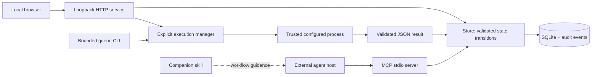

# Architecture and boundaries

Hosts can connect via MCP, or the user can enable a trusted worker configuration at startup. The execution manager claims one ticket, launches a fixed argv without a shell, bounds its duration/output and applies its result through the same domain rules. A profile is a recommendation; an assignment is ownership; a running process is not evidence of provider availability. Actual-model declarations are not measured telemetry.

## State and concurrency

Each command opens its own SQLite connection. Mutations use `BEGIN IMMEDIATE`; all fields and audit records for help/split are committed atomically. Readers use a snapshot transaction. Ticket writes compare `expected_revision`; a conflict requires rereading and reconciling context. Claiming requires a queued, ready ticket. Ownership remains on blocked work so another worker cannot edit a paused owner's task.

Parent-to-child edges and explicit dependency edges form one execution graph for cycle validation. A parent waits for unfinished children and cannot be claimed until they resolve. An explicit dependency requires `done`; a cancelled dependency does not qualify. A cancelled child can be excluded from parent completion. A manually blocked ticket stays blocked after its dependencies finish until explicitly requeued. Closing all children never closes the parent automatically.

Submission records evidence and enters review. Completion needs all criteria explicitly accepted, dependencies resolved, and a reviewer identity different from the assignee. These rules protect workflow integrity; they do not prove an artifact is correct or establish cryptographic identity.

## Trust model

Single trusted local OS user. HTTP uses loopback only, a Host allowlist, same-origin checks, a required custom mutation header and a static asset allowlist. No public serving, CORS or arbitrary file-reading endpoint. Execution requests choose an existing configured worker, never a command. The browser always acts as `human`; MCP identity comes from its command-line configuration. Another program with access to the database can bypass application rules, so this is not a security boundary against the local user or a malicious installed agent.

Evidence paths are inert references. No server-side fetching, uploads or inference keys in the web API. Worker commands are trusted code with local OS permissions; the manager is not a sandbox. Codex adds its own configured sandbox, while the Ollama adapter only generates a written report. Do not treat ticket text as authority to expand permissions. The companion skill preserves host permissions and user scope.

## Execution consistency

Claim and run creation commit together. One OS lock and a partial unique SQLite index prevent simultaneous managers/runs on the same database. Result application checks the original claim revision and owner before a transaction changes the ticket and run. Human/MCP edits are never overwritten. Ticket and run statuses in HTTP snapshots share one read transaction. Export and SQLite backup preserve run history without serializing executable configuration or credentials.

Cancel/timeout stop the owned process tree; errors block only the unchanged owned ticket. Restart recovers unfinished runs as interrupted and never retries automatically. A hard manager crash can leave OS children alive, so recovery requires inspection before a manual retry. Process lifetime isolation across crashes and across separate project databases is not claimed.

## Distribution

Python standard-library core; optional official MCP SDK 1.30.0; vanilla HTML/CSS/JS packaged as static resources. One database per project. Demo data and real data have separate default paths. SQLite files, environments, logs and local exports remain outside Git.

## Scope

The shipped core is ticket coordination, MCP, explicit worker execution, bounded queue dispatch and independent review. Provider usage metering, unattended scheduling, GitHub Issues synchronization and multi-user hosting are outside this release. See [execution protocol and operation](EXECUTION.md).
